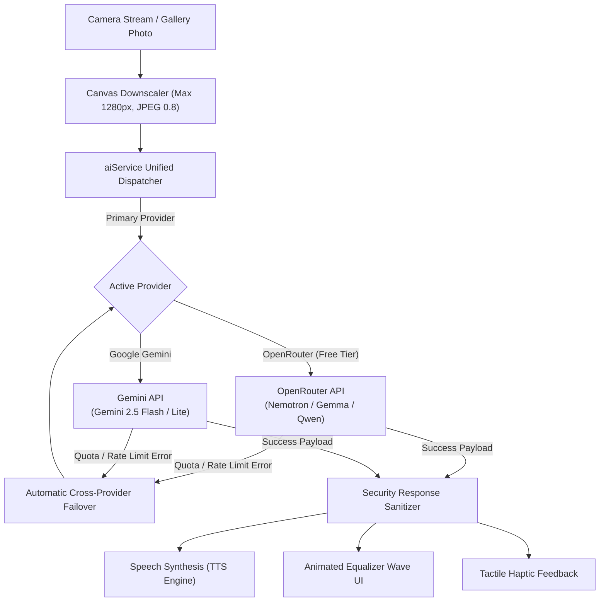

<div align="center">

# 👓 VisionVoice

### **Real-Time Multimodal AI Visual Aid for the Visually Impaired**

[](https://visionvoiceai.vercel.app/)
[](https://visionvoiceai.vercel.app/)
[](https://github.com/DevCodeHub99/vision-voice-ai/actions/workflows/ci.yml)

[](https://react.dev/)
[](https://www.typescriptlang.org/)
[](https://tailwindcss.com/)
[](https://vitejs.dev/)
[](https://vitest.dev/)
[](https://openrouter.ai/)
[](https://aistudio.google.com/)

</div>

---

## 📖 Overview

**VisionVoice** is an accessibility-first, privacy-focused Progressive Web Application (PWA) designed to empower visually impaired and low-vision individuals to perceive, navigate, and understand their environment. 

Using native browser media APIs, client-side pre-compression, and state-of-the-art multimodal vision models from **OpenRouter** and **Google Gemini AI Studio**, VisionVoice provides real-time natural language narrations and instant OCR text readout.

VisionVoice operates on a strict **Bring Your Own Key (BYOK)** model: **zero servers, zero databases, and zero tracking**. All images and API keys remain strictly on the user's device.

---

## 🏗️ Architecture & Data Flow



---

## ✨ Key Capabilities & Features

### 🔐 Multi-Provider BYOK & Hardened Client Security
- **Multi-Provider AI Architecture**: Seamlessly switch between **OpenRouter** (`sk-or-v1-...`) and **Google AI Studio** (`AIzaSy...`).
- **Resilient Fallback Cascades**: If the primary model fails with a transient 500 error or rate limit, requests automatically cascade to fallback models and across providers.
- **Fail-Fast Client Protection**: Immediate rejection on HTTP 401/402/403 errors prevents 120-second request freezes.
- **Header-Based Authentication**: Google Gemini requests use official `x-goog-api-key` headers; API keys never appear in URL query parameters.
- **XOR Salt Obfuscation**: Keys saved to browser storage are encrypted via XOR salt obfuscation to prevent casual DevTools inspection.
- **Strict Content Security Policy (CSP)**: `connect-src` is strictly locked down to `'self'`, `https://openrouter.ai`, and `https://generativelanguage.googleapis.com`.
- **Automated Error Redaction**: Global regex scrubbing masks key signatures (`sk-or-v1-***`, `AIzaSy***`, `key=***`) across all console logs and UI error sheets.

### 🎙️ Hands-Free Multilingual Voice Commands
- **Continuous Voice Control**: Execute hands-free actions across 8 languages:
  - **`Describe`**: Activates environment scene description mode.
  - **`Read`**: Activates direct OCR text extraction mode.
  - **`Capture`**: Takes a high-resolution photo instantly.
  - **`Stop`**: Immediately interrupts ongoing speech narration.
  - **`Repeat`**: Replays the latest AI description.
- **Acoustic Feedback Loop Isolation**: Microphone input is automatically suppressed while speech synthesis is active, preventing the device from triggering its own voice commands.
- **Word-Boundary Matching**: Uses script-specific regex boundaries (`\b`) to eliminate false positive command triggers (e.g. *"already"* does not trigger *"read"*).

### ⚡ Crisp, Concise Descriptions & OCR
- **Scene Description (`Task.DESCRIBE`)**: Tuned to deliver **2 to 3 crisp, direct sentences max**. Highlights primary subjects, spatial layout, and immediate safety hazards or obstacles first without introductory filler.
- **Direct Text Reader (`Task.READ`)**: Extracts visible signs, documents, labels, and menus with zero preamble.
- **Client-Side Image Compression**: High-resolution smartphone frames (up to 48MP) are downscaled to 1280px at 0.8 JPEG quality before transmission, reducing network payload sizes by up to 90% and slashing latency.

### 📲 Progressive Web App (PWA) Offline Support
- **Offline Application Shell**: Service Worker (`sw.js`) provides Stale-While-Revalidate caching for static assets, enabling instant app launches without network connectivity.
- **Network Connectivity Monitor**: Real-time `online`/`offline` listener surfaces visual status badges and auditory alerts when connectivity fluctuates.
- **1-Tap PWA Install**: Automatically displays an **"Install App"** button in the header when the browser triggers `beforeinstallprompt`.
- **App Shortcuts**: Quick-launch actions in `manifest.json` allow opening directly into *"Describe Scene"* or *"Read Text"* from the mobile home screen.

### ♿ Universal Accessibility (WCAG 2.1 AA) & Ergonomics
- **Self-Healing Error Boundary**: Catches unhandled runtime exceptions, renders a high-contrast recovery screen, and announces the error via speech synthesis: *"VisionVoice encountered an unexpected problem. Tap the center of the screen to reload."*
- **Speech Narration Speed Control**: Customize voice speed from **0.75x to 1.5x** via the settings slider.
- **Large Touch Targets**: All interactive elements adhere to minimum $48\text{px}$ touch targets (`touch-action: manipulation`).
- **Tactile Shutter & Viewfinder Reticle**: Shutter button features dual glowing border rings and spring compression; center reticle aids low-vision framing.
- **High Contrast Focus Outlines**: Enhanced `:focus-visible` styling (`outline: 2px solid #a78bfa`) and Windows Forced Colors Mode support.

---

## ⌨️ Accessibility Keyboard Shortcuts

| Shortcut | Action | Context |
| :--- | :--- | :--- |
| <kbd>Space</kbd> / <kbd>Enter</kbd> | Capture photo immediately | Camera mode |
| <kbd>D</kbd> | Switch to **Describe Scene** mode | Global |
| <kbd>R</kbd> | Switch to **Read Text / OCR** mode | Global |
| <kbd>U</kbd> | Switch to **Gallery Upload** mode | Global |
| <kbd>S</kbd> | Play / Pause voice narration | Active result |
| <kbd>V</kbd> | Toggle hands-free voice recognition | Global |
| <kbd>Esc</kbd> | Dismiss result sheet / close settings | Modals |

---

## 🤖 Supported Multimodal Models

VisionVoice is strictly designed for **multimodal vision tasks** (scene narration, obstacle/hazard detection, and high-precision OCR). Only models with confirmed `image` input capability (`input_modalities: ["image"]`) are included:

### OpenRouter (Free Multimodal Tier)
All preset OpenRouter models are 100% free (`$0` input / `$0` output tokens) and purpose-built for visual understanding:

| Model ID | Specialization | Role in VisionVoice |
|---|---|---|
| **`openrouter/free`** *(Default)* | Auto Free Vision Router | Automatically filters and routes to the best active free model with image understanding. Never gets locked out by single-model rate limits. |
| **`qwen/qwen2.5-vl-7b-instruct:free`** | Top Vision-Language OCR | Flagship open vision model from Alibaba; best-in-class for reading street signs, food labels, medicine bottles, and fine text. |
| **`meta-llama/llama-3.2-11b-vision-instruct:free`** | Fast Edge Vision | Meta's mobile-optimized vision model; lowest latency for immediate obstacle awareness and scene descriptions. |
| **`google/gemma-4-31b-it:free`** | High-Res Reasoning | Google DeepMind open-weights multimodal model; high visual fidelity for intricate spatial layouts. |
| **`nvidia/nemotron-3.5-super-vl:free`** | 1M Context Vision MoE | NVIDIA vision mixture-of-experts model with 1M context; excels at multi-object spatial mapping. |
| **`google/gemma-4-26b-a4b-it:free`** | Rapid Vision | Fast multimodal inference for continuous surroundings checks. |
| **`nvidia/nemotron-3-nano-omni-30b-a3b-reasoning:free`** | Spatial Reasoning | Step-by-step perception reasoning for navigating complex indoor/outdoor obstacles. |
| **`custom`** | User-Provided Vision Model | Enter any valid OpenRouter model ID (e.g. `thinkingmachines/inkling-2-small:free`). |

> [!TIP]
> **Why no text-only models?** General text models (like standard Llama 3 8B or Mistral 7B) cannot process visual tokens and will return `400 Bad Request`. VisionVoice only connects to models that natively support image understanding.

### Google Gemini (AI Studio BYOK)
* **`gemini-2.5-flash`** *(Recommended)*: Industry-leading multimodal reasoning, fast audio/visual perception, and native safety filters.
* **`gemini-2.5-flash-lite`**: Ultra-low-latency vision responses for immediate shutter turnaround.
* **`custom`**: Enter any custom Google AI Studio model identifier.

---

## 📁 Repository Directory Structure

```text
vision-voice-ai/
├── components/
│   ├── BottomNav.tsx        # Accessible mode tablist & glowing tactile shutter
│   ├── CameraCapture.tsx    # Live WebRTC video feed, canvas downscaler & track guards
│   ├── ErrorBoundary.tsx    # Accessible React Error Boundary with vocalized reload
│   ├── Header.tsx           # Language picker, offline badge, PWA install & status pill
│   ├── ResultSheet.tsx      # Slide-up modal with 5-bar equalizer wave & Web Share
│   └── SettingsModal.tsx    # Multi-provider BYOK, model selector & speech rate slider
├── hooks/
│   ├── useCamera.ts         # Imperative camera handle & capture coordination
│   ├── useHaptics.ts        # Memoized navigator.vibrate tactile feedback
│   ├── useImageProcessing.ts# AI state machine & analysis orchestrator
│   ├── useSpeech.ts         # Speech synthesis with keep-alive heartbeat & speechRate
│   └── useVoiceCommands.ts  # Multilingual hands-free voice command recognizer
├── services/
│   ├── aiService.ts         # Unified provider dispatcher with cross-provider failover
│   ├── geminiService.ts     # Lightweight Google Gemini REST client (header auth)
│   └── openRouterService.ts # Lightweight OpenRouter REST client (fail-fast 4xx)
├── utils/
│   ├── imageProcessor.ts    # Canvas downscaler (max 1280px) & JPEG 0.8 compressor
│   └── security.ts          # XOR key obfuscation, key sanitization & regex scrubbing
├── tests/
│   ├── aiService.test.ts          # Multi-provider routing & failover test suite
│   ├── errorBoundary.test.ts      # Error Boundary speech announcement test suite
│   ├── geminiService.test.ts      # Gemini header authentication & cascade tests
│   ├── imageProcessor.test.ts     # Aspect ratio & downscaling calculation tests
│   ├── openRouterService.test.ts  # OpenRouter headers, cascades & 4xx fail-fast tests
│   ├── security.test.ts           # XOR cipher, redaction regexes & text cleaner tests
│   └── voiceCommands.test.ts      # Multilingual command parser test suite (8 languages)
├── public/
│   ├── icon.svg             # High-contrast accessibility app icon
│   ├── manifest.json        # Standalone PWA configuration with app shortcuts
│   └── sw.js                # Service Worker for offline application shell caching
├── App.tsx                  # Root orchestrator, shortcuts & connectivity listener
├── constants.ts             # 8 languages, prompt templates, system instructions & models
├── index.css                # Tailwind CSS v4, safe area insets & focus-visible styles
├── index.html               # PWA shell, Content Security Policy (CSP) & permissions
├── index.tsx                # React 19 root bootstrap & Service Worker registration
├── package.json             # NPM dependencies, allowScripts & build commands
├── tsconfig.json            # Strict TypeScript configuration
├── types.ts                 # TypeScript type definitions and interfaces
├── vite.config.ts           # Vite build configuration with Tailwind v4 & React plugin
└── vite-env.d.ts            # Vite client environment type declarations
```

---

## 🚀 Getting Started

### Prerequisites
* **Node.js**: v18.0.0 or higher.
* **API Key**: An [OpenRouter API Key](https://openrouter.ai/keys) or [Google AI Studio Key](https://aistudio.google.com/app/apikey).

### Installation

1. **Clone the repository:**
   ```bash
   git clone git@github.com:DevCodeHub99/vision-voice-ai.git
   cd vision-voice-ai
   ```

2. **Install dependencies:**
   ```bash
   npm install
   ```

3. **Start the local development server:**
   ```bash
   npm run dev
   ```
   Open `http://localhost:5173/` in your browser.

4. **Configure your API Key:**
   - Click the **Setup Key** pill or **Settings gear icon** in the top right.
   - Choose your provider (**OpenRouter** or **Google Gemini**), paste your key, and tap **Save Settings**.

---

## 🧪 Testing & Verification

VisionVoice features a deterministic Vitest test suite covering security, services, voice parsing, image processing, and error recovery:

```bash
# Run all unit and integration test suites
npm test

# Run tests in watch mode
npm run test:watch

# Run TypeScript strict type-checking
npm run typecheck

# Build optimized production bundle
npm run build
```

---

## 🌐 Browser Compatibility

| Feature | Chrome / Edge | Safari (iOS / macOS) | Firefox | Samsung Internet |
| :--- | :---: | :---: | :---: | :---: |
| **WebRTC Camera (`getUserMedia`)** | ✅ Yes | ✅ Yes (14.3+) | ✅ Yes | ✅ Yes |
| **Speech Synthesis (TTS)** | ✅ Yes | ✅ Yes | ✅ Yes | ✅ Yes |
| **Speech Recognition (Voice Commands)** | ✅ Yes | ⚠️ WebKit (limited) | ⚠️ Partial | ✅ Yes |
| **Haptic Feedback (`vibrate`)** | ✅ Yes (Android) | ❌ Unsupported by Apple | ✅ Yes (Android) | ✅ Yes |
| **PWA Installation & Offline** | ✅ Yes | ✅ Add to Home Screen | ✅ Yes | ✅ Yes |
| **Web Share API (`navigator.share`)** | ✅ Yes | ✅ Yes | ⚠️ Mobile only | ✅ Yes |

---

## 📄 License

This project is open-source under the terms of the [MIT License](LICENSE).

<div align="center">

Built with ❤️ for a more accessible, inclusive world.

</div>
